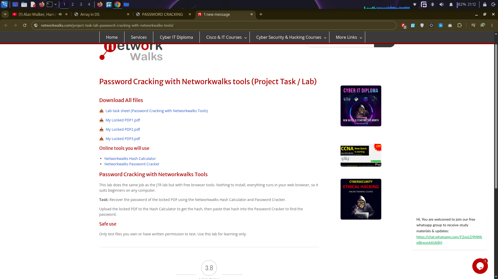
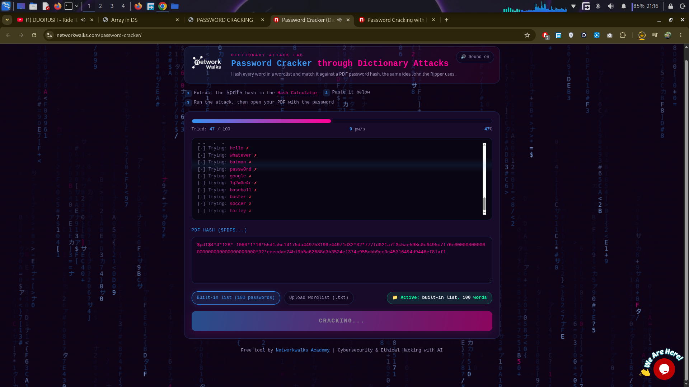
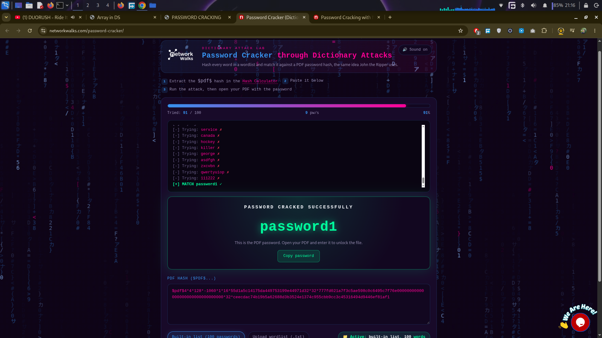

# Password cracking using networkwalks tools
## steps
1. Download the encrypted pdf file from networkwalks website

2. open the networkwalks Hash Calculator in your web browser
3. Upload the locked file to the hash calculator.
4. copy the hash from the tool

5. Open networkwalks password creacker tool
6. paste the hash you copy from the hash calculator
7. click on 'start cracking' open
   
8. the tools start to create password from the hash
9. copy the password create by the tool
   
10.  open the locked pdf file and enter the cracked password
11.  Enter the password1
12.  your pdf will open

