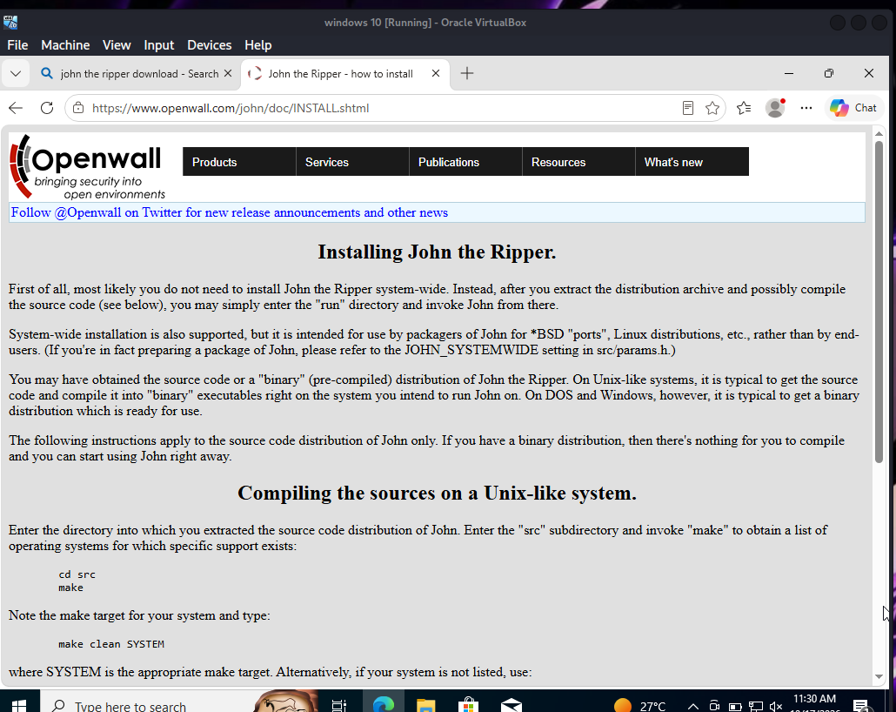
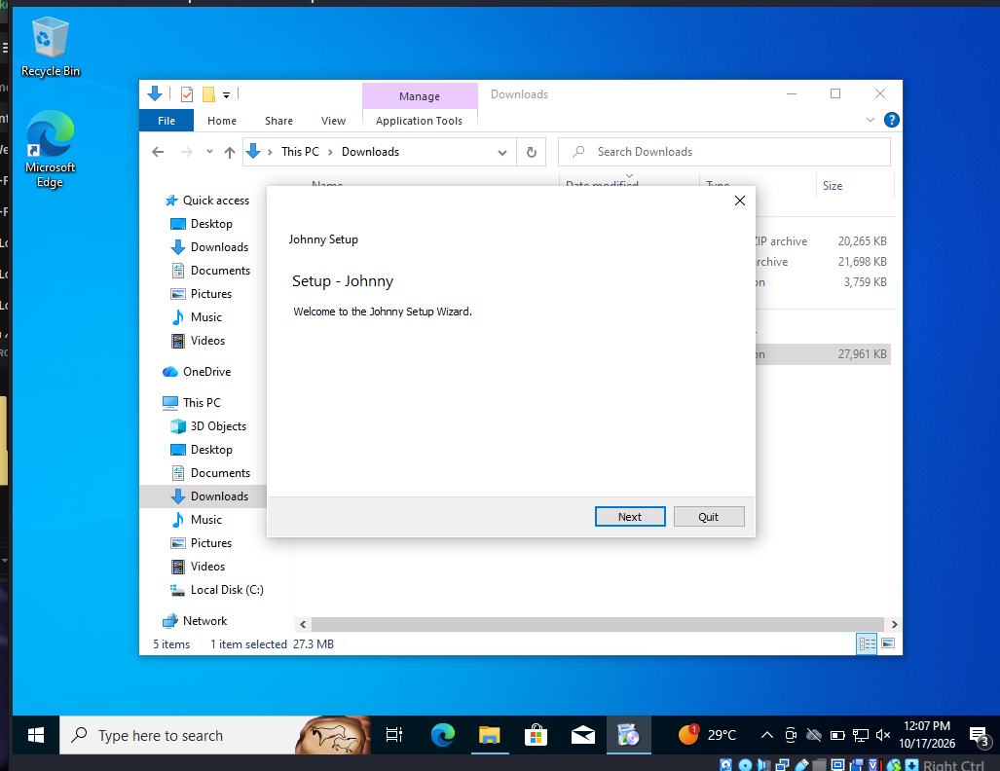
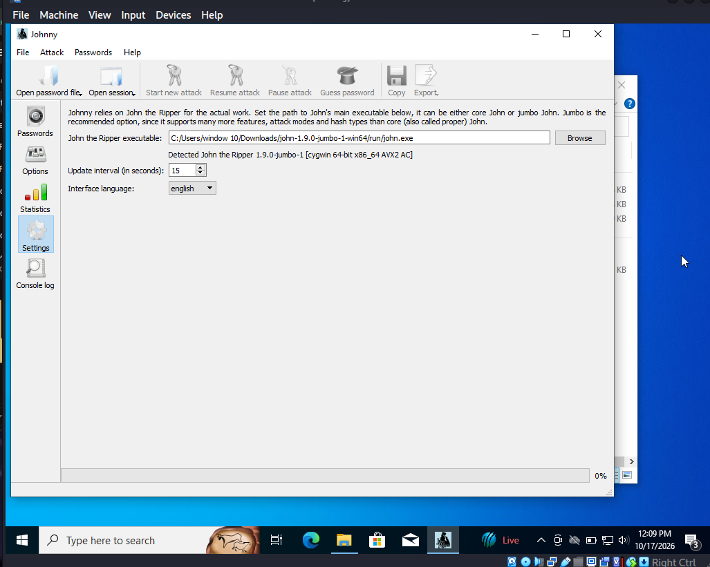
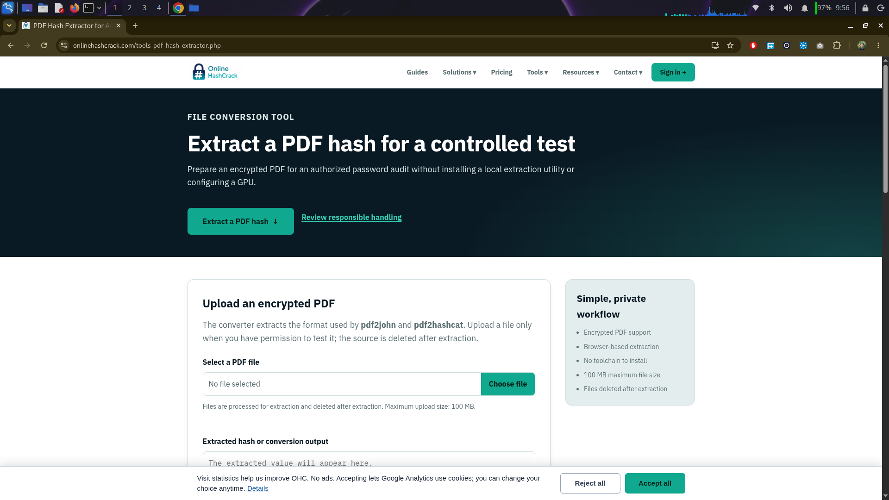
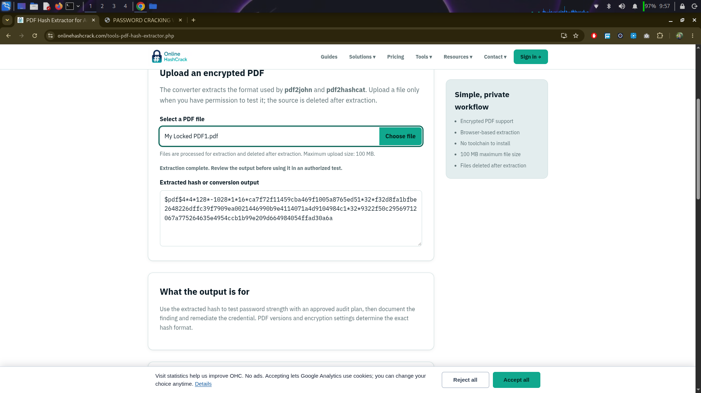
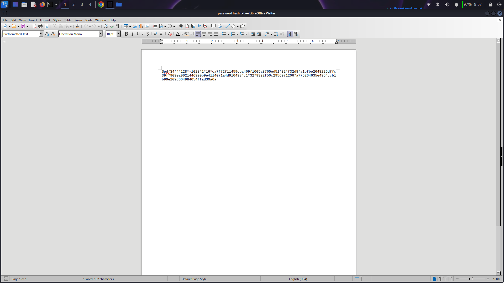
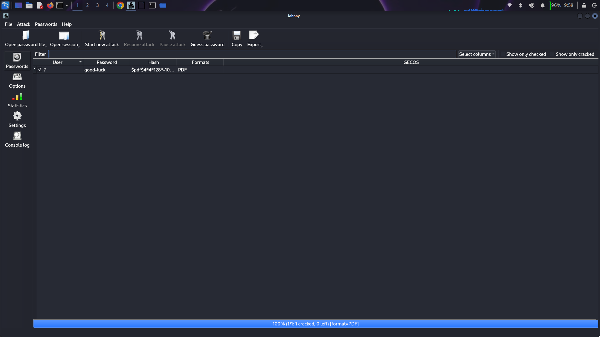

# NETWORKWALKS-B084-WK3-CYBERSECURITY-JTR-PASSWORD-CRACKING
# Password cracking via johnny 
## John the ripper
1. first of all go to john the ripper offical website on browser
2. Then download the file
3. unzip the file you download from browser

4. After that download Johnny for Graphical use
5. first unzip the file and  Install the Johnny file

6. After installation open the app and go to setting
7. select john.exe file from already download john file

8. open hash cracker app

9. Browse the PDF file & click on Upload
10. Select and copy the hash

11. Save the hash into notepad
12. save the notepad in .txt form

13. open johnny
14. click on 'open password file'
15. Browse to the hash1.txt file that you have just saved & click on Open
16. click on 'strat attack'

17. copy  password, open your file and paste on the bix of password
18. Now the file is open

